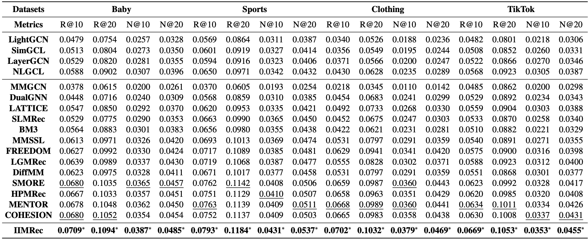

# [IIMRec] One Graph, Multiple Gains: Single High-Quality Item-Item Graph for Multimodal Recommendation

## Introduction

This is the Pytorch implementation for IIMRec paper:

```
One Graph, Multiple Gains: Single High-Quality Item-Item Graph for Multimodal Recommendation
```

## Environment Requirement
  ```
  cd ./src
  python main.py
  ```

## Dataset
 ```
All experiments conducted on four processed datasets: Baby, Sports, Clothing, TikTok
 ```
## Training
  ```
  cd ./src
  python main.py
  ```
## Result

